WhereWolf
=====

WhereWolf records your location in the background and sends it to a server you
choose. Records can include GPS coordinates, motion state, steps, and battery
level. The app keeps data locally while offline and uploads it in batches when
a connection is available.

WhereWolf is made by [SoPat712](https://github.com/SoPat712). It started from
[Overland](https://github.com/aaronpk/Overland-iOS) by Aaron Parecki and keeps
Overland's API, so services built for Overland work with it.

[Support](https://sopat712.github.io/WhereWolf/) ·
[Privacy policy](https://sopat712.github.io/WhereWolf/privacy/)

You can use an existing backend or build an HTTP receiver. Supported services
and integrations include:

* [Compass](https://github.com/aaronpk/Compass) - a self-hosted PHP app for storing and reviewing Overland data
* [Wayfinder](https://github.com/dontic/wayfinder) - a self-hosted app for Overland
* [Dawarich](https://dawarich.app/) - a self-hosted alternative to Google Location History
* [Reitti](https://www.dedicatedcode.com/projects/reitti/) - self-hosted location tracking and analysis
* [PureTrack](https://puretrack.io/add-overland) - tracking for lightweight planes and gliders
* [Open Humans](https://overland.openhumans.org/) - location recording and data sharing for research
* [Icecondor](https://icecondor.com/) - location sharing and geofence alerts
* [Geomanic](https://geomanic.com/) - a hosted trip tracking service
* [Home Assistant](https://www.home-assistant.io/) - integration through its [OwnTracks](https://www.home-assistant.io/integrations/owntracks/) support

For Android, see [Colota](https://github.com/dietrichmax/colota) and its
[Overland integration](https://colota.app/docs/integrations/overland).

## Setup Guide

On first launch, nine glass panels float over the map: Welcome, Permissions,
Destination, Tracking, Fine-Tune, Sending, Live Activity, Staying Active and Done.
Panels fit without scrolling at the default text size on 390/402-point phones;
larger text can scroll when needed. Permissions includes While Using, Always, Precise Location,
optional Motion & Fitness, notifications and Apple Health. Permissions are requested
only when you tap their buttons. Denied or limited location, motion or notification
access offers Open Settings; returning refreshes the status. Apple Health offers
Allow until its request is answered, then shows Reviewed and Manage in Health
when the Health app can open. Change access in the Health app; read approval stays
private. The row is hidden when HealthKit is unavailable.

Paste a `wherewolf://setup` or `overland://setup` link from your server, enter an
HTTP(S) endpoint and token with GeoJSON or OwnTracks format, choose iCloud Drive,
or keep records on the device. Keeping records on the device clears the server
endpoint and disables iCloud export; queued records remain available to send later.
Tracking lists six presets with descriptions and a checkmark. Everyday Detailed
is preselected on new installs; existing settings stay saved. Fine-Tune adjusts
requested accuracy, minimum distance and time between points, automatic pausing
and visit tracking. Edits take effect immediately through the main app's settings
and change the preset to Custom. All Tracking Settings opens the full controls.

The final summary opens Tracking for preset changes and Fine-Tune for accuracy
or point filters. **Start Tracking** begins recording with your current settings;
**Finish Without Tracking** and **Skip All**
complete setup without starting it. Reopen the guide from the first row in
Settings at any time. Skip advances one step; touch and hold it for Skip All.
An existing recording continues when you reopen it.

## Backup, connection tests and coverage

Settings → **Backup & Sync** exports one JSON settings file and imports it after a
validated change preview. **Include Server URL and Token** defaults on; that file
also includes custom headers and contains your server credential. Keep it private.
Turn it off to omit all three. Backups contain configuration, Wi-Fi place points and
networks, and trip modes, without locations, queues, trips, imported workouts or
Health records. Older Wi-Fi place and zone backups still import.
Import preserves tracking on/off and waits until the current trip ends. Permissions
must be configured separately on each iPhone.

Optional iCloud settings sync defaults off. It merges the latest change per setting;
server URL, token and custom headers use iCloud Keychain, while other settings use
Apple's key-value storage. Device ID stays on each device but is included in file
backups. Incoming changes wait until a trip ends. Turning sync off stops further
syncing on this iPhone; already synchronized values remain in iCloud. The installed
build needs the iCloud key-value entitlement. Credential delivery depends on iCloud
Keychain and is checked when the app becomes active.

**Test Connection**, in Settings → Server and the setup guide's server sheet, saves
your edits and immediately sends one current location as a real point. It uses a
fix from the last 30 seconds or requests one with a 15-second timeout. GeoJSON adds
`test: true`; OwnTracks uses its usual plain location object. The test uses your
headers and token, works on cellular even with Send Only on Wi-Fi enabled, and
leaves the queue, history, trips and send statistics unchanged. Its inline result
shows the HTTP status and acknowledgement or a specific fix hint.

Settings → **Coverage**, beside Local History & Replay, shows the last 24 hours or
7 days, bounded by history retention. Recorded, paused and gap spans distinguish
intentional pauses from more than 10 minutes without an accepted fix while tracking
was expected. Tap a gap for its times and duration. Reception and filters can also
cause gaps; a gap alone does not prove iOS terminated the app. The screen includes
hourly point counts, send totals and the last error, queued points, and
links to keep-alive settings. Earlier sessions retain error categories. Its protected local state log starts with this version;
earlier periods are unknown. It keeps at most 2,000 transitions and 20,000 send
attempts within the history window, contains no coordinates and never uploads.

## Screenshots

A simulated day in Tokyo, recorded in the iOS Simulator. The routes come from Apple Maps
directions, so the trails follow the same streets as the map.

<table>
<tr>
<td align="center" width="33%">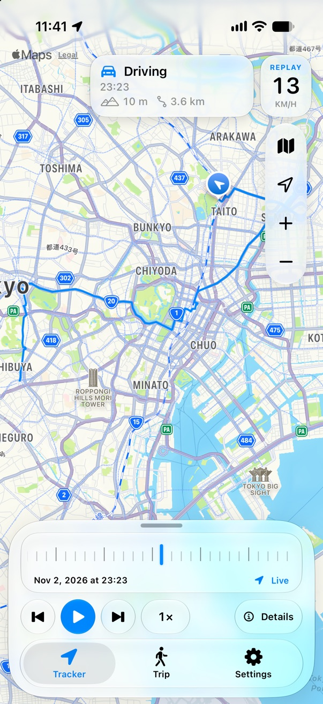<br>A day in Tokyo, replayed</td>
<td align="center" width="33%">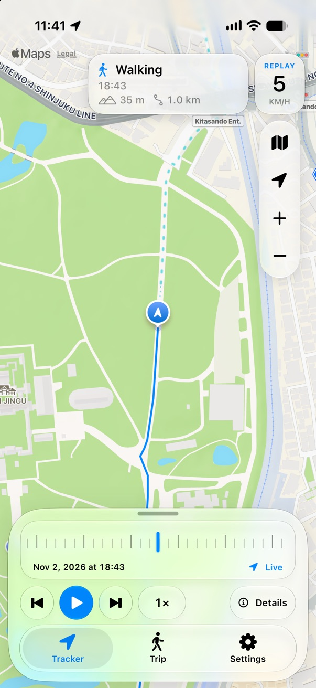<br>Walking through Meiji Jingu</td>
<td align="center" width="33%">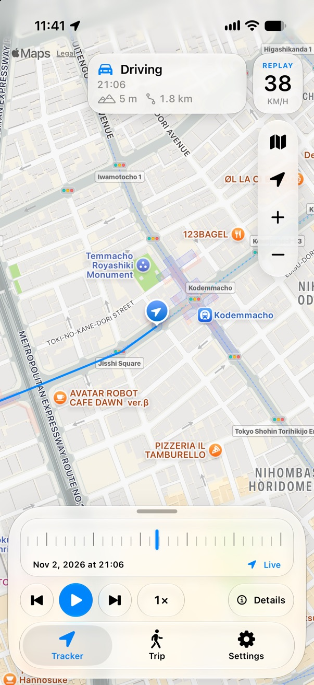<br>Driving through Nihonbashi</td>
</tr>
<tr>
<td align="center" width="33%">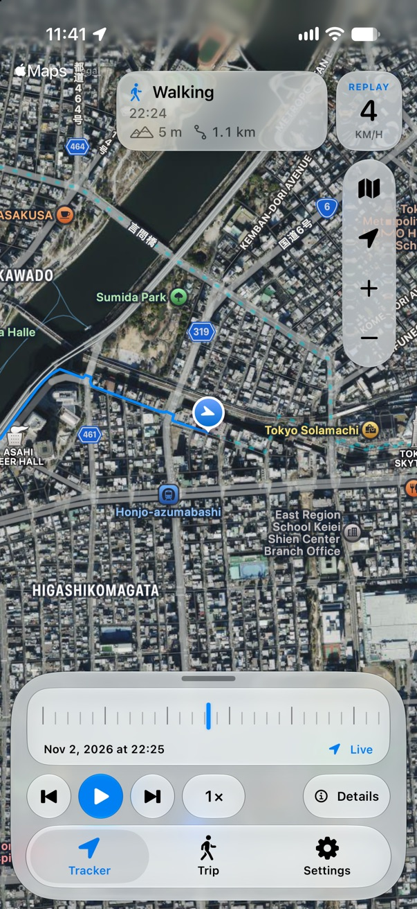<br>Satellite, over the Sumida River</td>
<td align="center" width="33%">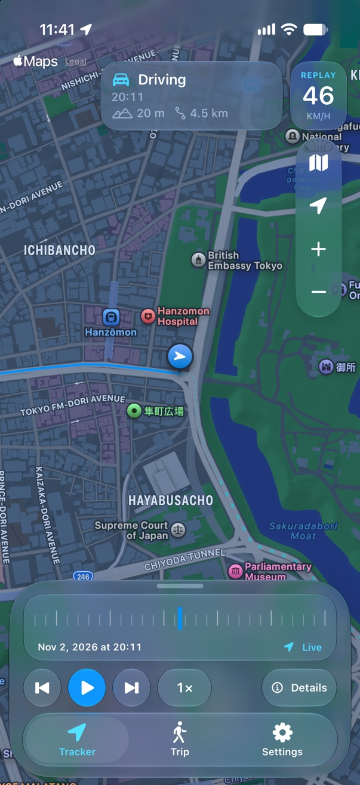<br>Dark mode by the Imperial Palace</td>
<td align="center" width="33%">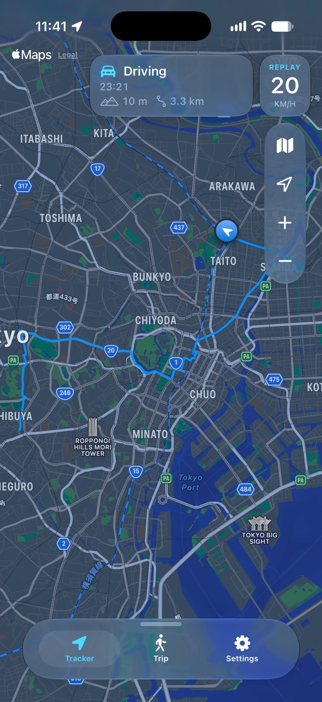<br>The whole day, drawer closed</td>
</tr>
<tr>
<td align="center" width="33%">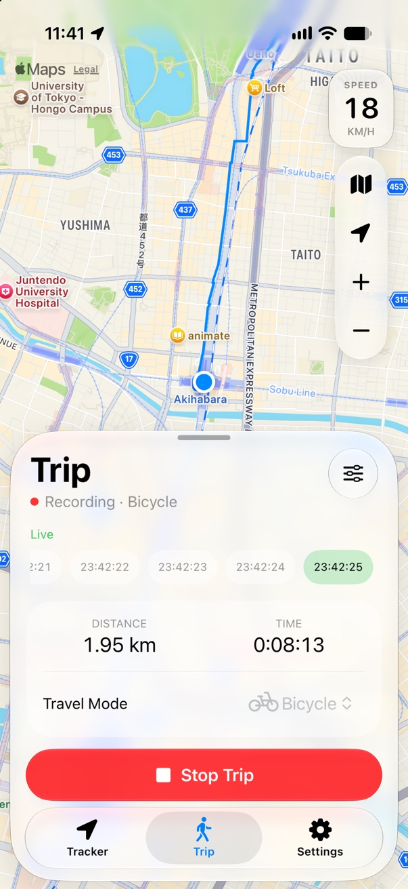<br>A bike trip from Ueno to Akihabara</td>
<td align="center" width="33%">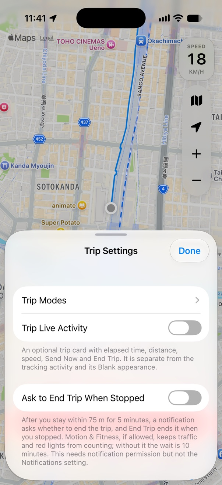<br>Trip Settings</td>
<td align="center" width="33%">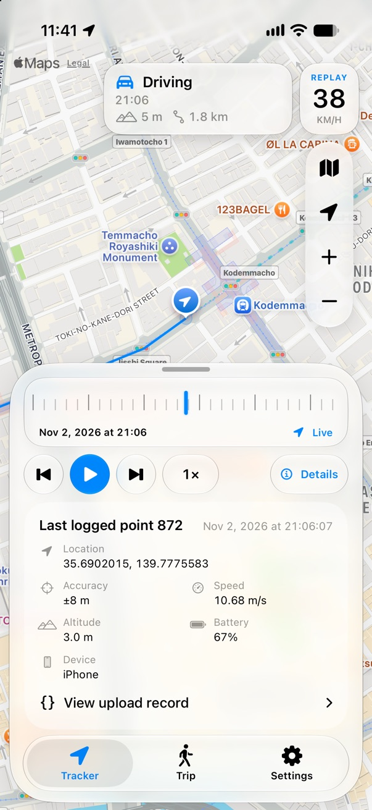<br>Details for a recorded point</td>
</tr>
<tr>
<td align="center" width="33%">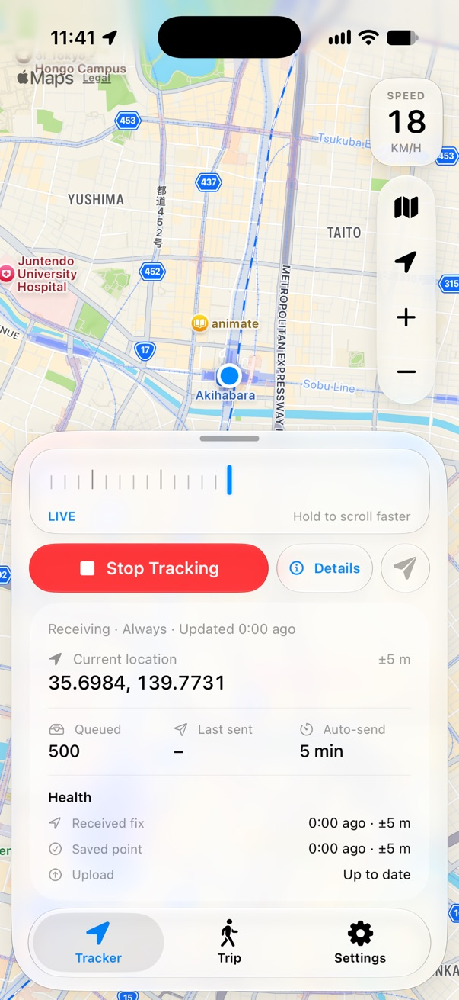<br>Live location details</td>
<td align="center" width="33%">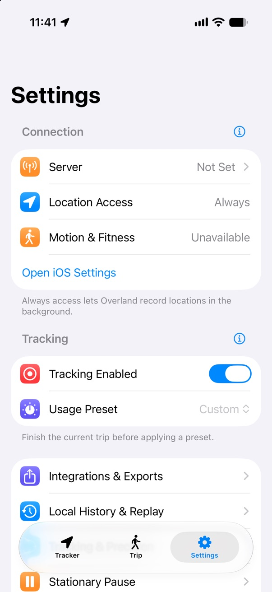<br>Settings</td>
<td align="center" width="33%">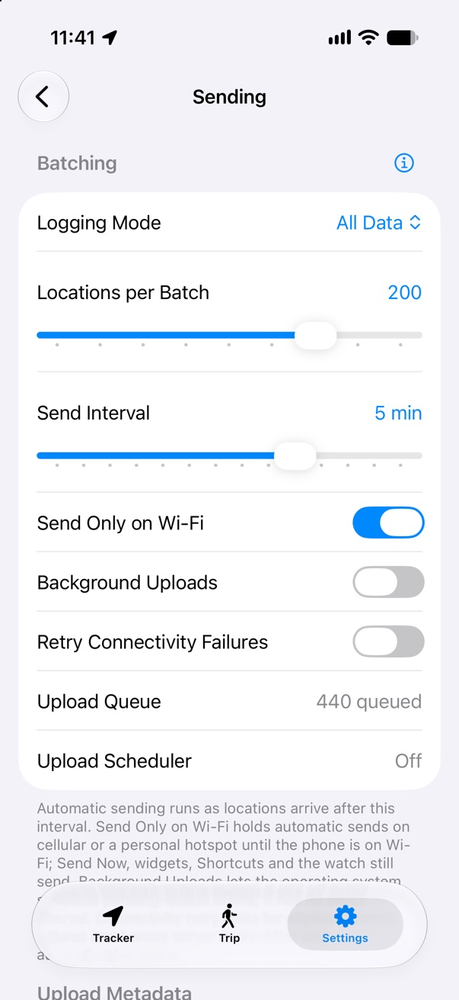<br>Send Only on Wi-Fi</td>
</tr>
</table>

## About WhereWolf

WhereWolf uses SwiftUI screens inside a UIKit shell, with Liquid
Glass on iOS 26 and later and material backgrounds on earlier versions. It
requires iOS 17.

Tracker and Trip share a map with a Find My style drawer. Collapsed, the drawer
is a single glass capsule holding the grabber and the Tracker, Trip, and Settings
tabs and spans about 85% of the screen width. Drag the grabber or the tabs upward,
or tap a map tab, to open it; it widens to about 95% as it rises. Open, it
shows a glass timeline and one compact control row, with the tabs in their own
capsule at the bottom. Details default closed: use the labeled Details capsule
for current location data or the selected replay point. Closing details restores
the compact drawer. Fitting content stays flat, without vertical scrolling or
bounce. On small screens or with large text, the drawer stops at the available
height and lets overflowing content scroll. Tab changes immediately retarget
the drawer's current animation to the new content height. Drag
sideways across the drawer tabs to switch pages. Settings hides the map and
uses iOS's own tab bar, with native Liquid Glass on iOS 26 and later. The drawer's
glass shrinks into the native bar while its tab icons and labels keep their size,
landing exactly on the native ones; returning grows it back into the closed capsule. Selecting another tab during
the move retargets it from its current size. Reduce Motion swaps the bars instantly.
Before iOS 26, the glass changes into the full-width native bar with square corners.
Settings content uses the system safe area throughout the transition. Sliders
have common-value detents and selection feedback, and still support exact numeric entry. Dragging previews a setting;
releasing saves it once.

Pinch the history ruler to change its scale: spread for finer steps, or pinch
in for coarser ones, from every recorded point to the whole loaded history.
The scale stays where you leave it across tabs and playback, and returning to Live
from history resets it to every point. Drag or flick
with one finger to browse at that scale, with momentum. Hold for a moment to
scrub sideways; moving vertically leaves the scale unchanged.
During a pinch or hold, a Liquid Glass bubble above the drawer shows the selected
time and the estimated time per bar (blur material before iOS 26). Coarser scales
zoom out around the live location or replay point and keep that zoom after release,
including during momentum and playback. **Every point** returns to that mode's original follow zoom.
Overview stays in overview. Holds and pinches use cached point details and load
the final selection on release. Reaching Live keeps the gesture active so you can
scrub back; releasing there returns to Live, and a flick returns as soon as it reaches the edge. Trip Settings starts
with a translucent glass background and fades toward the grouped Settings
background as the sheet expands; collapsing reverses the fade. Cards use the
same secondary grouped colors as the main Settings form in light and dark mode.

UIKit handles the drawer's drag gestures and detents; SwiftUI draws its tabs. The
drawer uses interactive `UIGlassEffect` on iOS 26 and later, with a material
fallback on older versions. Its spring follows the display's available refresh
rate, up to 120 Hz on ProMotion iPhones. The app enables
`CADisableMinimumFrameDurationOnPhone`; iOS still controls the actual rate.
Drawer geometry and map-credit positioning stay in UIKit so animation frames
do not rebuild the SwiftUI root. The tabs stay in place as the drawer resizes.

Settings → Support → Tip Jar opens a SwiftUI screen with a bottom selector for
SoPat712, who makes WhereWolf, and aaronpk, who created Overland. SoPat712's
page keeps the existing one-time, monthly, and yearly in-app tip products and
Restore Purchases, using StoreKit 2. Aaron's page offers one-time $5, $10, $25,
or custom USD tips through Cash App, PayPal, or Venmo only when StoreKit reports
the US App Store storefront; otherwise it shows his open-source credit and a
link to Overland on GitHub. The payment links open in the browser. The legacy
Tip Jar controller and main storyboard have been removed.

WhereWolf includes PR #180's precision controls, accuracy filter, and stationary
stopping, plus its later notification, persisted pause-state, and safe-settings
follow-ups. It also adds Wi-Fi Places with network names and saved points,
custom HTTP headers, server-certificate diagnostics, and the last 50 send
outcomes for the current app session.

Overland features through October 28, 2026 include editable trip modes,
Shortcuts and Siri actions, widgets and Control Center controls, an optional
trip Live Activity, iCloud Drive exports, Apple Health workouts and routes,
stationary-point filtering, and Wi-Fi place editing on a map. These use the
app’s existing screens and glass styling. Health, iCloud, Wi-Fi identity and
widget sharing require the corresponding signing capabilities. See the
[integration notes](docs/upstream-integration.md) for behavior and build options.
The Today widget shows today's archived distance and point count, the last fix and tracking
state on the Home Screen or Lock Screen, and resets at local midnight without opening the app.
Siri phrases work with or without the word "trip", such as "Start a walk in WhereWolf",
and Siri learns from the trips and tracking changes you make in the app.
Siri also accepts the app names "Werewolf" and "Where Wolf", such as
"Start a walk in Werewolf" or "Send Where Wolf data now".
The Home Screen quick actions show Stop Trip during a trip and your trip modes otherwise,
and update whenever a trip starts or ends.
Trip icons include Google’s [Material Symbols](https://github.com/google/material-design-icons),
licensed under Apache License 2.0. Saved or remote `where.*` icon names still resolve
to the renamed `wherewolf.*` assets.

Queue and networking fixes address empty OwnTracks sends, incorrect timestamps,
and batch counts. The location source preserves custom accuracy and pause
settings. Background reliability and battery use still need real-device testing.

See [AGENTS.md](AGENTS.md) for build commands and [BATTERY_AUDIT.md](BATTERY_AUDIT.md)
for unresolved background-tracking findings. Battery improvements require device
measurements; simulator checks do not establish energy savings.

## Tracking correctness and diagnostics

Presentation work pauses when no scene is active. Background location delivery,
recording, uploads, reminders and Live Activity updates remain independent of
scene visibility. Replay catches up when Tracker becomes visible; the trip map
loads when Trip becomes visible.

Wi-Fi Places match a connected network name within 300 m of the saved point, plus
reported uncertainty capped at 200 m. Place’s Point replaces only the fresh current
fix, preserving its timestamp. Its accuracy is 300 m or the fix’s own, whichever is
smaller, so Max Saved-Point Error keeps it whenever it would keep the fix. Nothing
skips matching fixes without stopping location services.
Historical fixes remain unchanged when recording a place’s point. Future-dated fixes and repeated identical fixes
are rejected; delayed history has no blanket age cutoff. Radius pausing uses
validated raw fixes before recording filters and resets on tracking, preset
and trip transitions. Automatic pausing still ends a trip.

Successful uploads drain eligible backlog without waiting for another fix.
Send Now, pause and trip-end flushes include the remaining partial batch.
Transient failures back off from 5 seconds to one hour with jitter; 429/503
Retry-After deadlines take precedence. Authentication and configuration failures
retain the queue and wait for changed server settings or Send Now. Error alerts
are limited to one per five minutes. Failed queue commits do not advance the
accepted-fix baseline, and failed trip-summary commits leave the trip available
to retry. Trip distance updates incrementally from committed trip points.

Settings → Tracking & Precision includes **Use new location engine**, off by
default. It selects `CLLocationUpdate.liveUpdates` for continuous acquisition,
using the selected activity type. iOS may pause GPS when stationary and resume
it automatically; the stream cannot enforce numeric desired accuracy or a
pause-off policy. Preset values, recording filters, significant changes, visits
and radius pause remain unchanged. The toggle is disabled when continuous
updates are unavailable and is never selected by a preset. Turning it off
preserves the existing engine selection, including Custom Best with automatic
pause. Tracker shows engine health and location authorization. A failed live
stream gets at most three retries per activation, then switches to
`CLLocationManager`. The failure stays latched until an explicit start, Retry,
engine change, refresh, or restored location authorization. Returning to the
foreground does not start an endless retry cycle.

The Location Engine info button explains benefits, tradeoffs, pausing in both
engines, trip behavior, background fallback and defaults. Automatic pausing ends
an active trip; the new engine can pause even when the trip pause setting is off.

The original engine also supports automatic pausing when enabled. With Always
location access and the background indicator off, live updates require an active
Status, Minimal, or Blank with **Lock Screen Card** on. Blank with the card off
uses the original engine: its app-only activity does not keep the live-update
stream delivering in the background.
Without a supporting activity, WhereWolf also uses the original engine to honor
the indicator setting. Activity creation, dismissal and expiry update that selection
without changing saved preferences. Trips retain their separate indicator setting.

### Optional tracking policies

These controls are independent of Usage Presets. They default off and retain
their values when a preset changes. Each section has an info button explaining
its behavior and limits.

- **Motion & Adaptive Tracking** provides an explicit Motion & Fitness
  permission button, motion-assisted recovery, a separate choice to resume a
  radius pause on movement, and configurable confidence. Motion describes
  activity; it does not improve GPS accuracy or wake a suspended app by itself.
  Recorded GeoJSON motion labels use the activity at the fix's timestamp.
- **Adaptive Tracking** can lower requested accuracy after a confirmed stop.
  Dwell, cluster radius, confirmation accuracy, idle accuracy and exit radius
  are configurable. Motion confirmation is required by default; without it,
  tracking stays detailed. You can choose GPS-only confirmation instead. Coarse
  updates continue and an exit region with Always access helps restore detailed
  tracking, but departure detection can be delayed. Trips require a separate
  opt-in. While moving, the saved accuracy and engine settings apply.
- **Point Selection & Quality → Any threshold** changes saved-point selection
  from distance AND time to distance OR time OR a configurable turn. Only
  enabled thresholds participate. A turn requires a usable course while moving.
  These are recording rules, not guaranteed GPS delivery intervals.
- **Reject Implausible Jumps** compares displacement, elapsed time and both
  fixes' reported uncertainty against a configurable speed limit. A second
  nearby fix at least one second later can confirm a relocation. It preserves
  original coordinates and timestamps; flight users can raise the limit or
  leave it off.
- **Trip Settings → Ask to End Trip When Stopped** sends one notification per
  stop during a trip: 75 m for 5 minutes, or 10 minutes without Motion & Fitness
  access. Its End Trip action ends the trip, and its Health workout, at the time
  you stopped. Turning it on asks for notification permission; it does not need
  the Notifications setting.
- **Sending → Send Only on Wi-Fi** holds the sends WhereWolf starts itself while
  the phone is on cellular or a personal hotspot, and sends them once it is on
  Wi-Fi. Wi-Fi in Low Data Mode still sends, and iCloud Drive saves are not
  held. Send Now, widgets, Shortcuts, Control Center, the Live Activity and the
  watch always send. Tracker shows "Waiting for Wi-Fi to send" while points wait.
- **Sending → Background Uploads** asks iOS for network-connected processing
  time when an eligible queue remains. iOS decides when it runs. **Retry
  Connectivity Failures** separately retries a network failure when an observed
  connection returns. Both reuse the existing uploader, acknowledgment rules
  and queue. Server Retry-After and authentication blocks remain in force.
- **Background → Explicit Service Session** retains an iOS 18+ authorization
  session while continuous tracking is enabled and Always access is already
  granted. It does not request a permission upgrade or guarantee execution.
- **Background → Background Recovery Monitoring** adds significant-change
  monitoring alongside Standard tracking and trips. It defaults off and requires
  Always access and device support. This gives iOS another opportunity to relaunch
  WhereWolf after system termination; it cannot promise a wake interval or bypass
  force-quit. The page also shows the system Background App Refresh status.
- **Background → Location Updates & Recovery** contains two independent,
  default-off options. **Automatically Retry Location Updates** checks for missing
  updates or old readings while continuous tracking is expected. The default wait
  is two minutes, adjustable from one to thirty minutes. It makes at most three
  attempts per app session without a fresh fix, waiting longer between attempts.
  Fresh locations reset the limit even when point filters reject them. Stop,
  automatic pauses, stationary radius pauses, adaptive power saving and lost
  permission prevent retries. The check cannot wake a suspended app or recover
  points that were never received.
- **Save Location Health Log**, on that same page, keeps up to 200 events for seven
  days in a protected, backup-excluded local file. Entries describe observed gaps,
  retries and reasons points were skipped. They contain no coordinates, server
  addresses or credentials. Share and clear actions are explicit; turning the log
  off stops new entries and preserves saved ones. The log cannot prove why iOS
  stopped running the app.

Received location batches automatically request a short background execution
allowance before saving. It covers the queue commit and waits for local history
and Health route writes already queued by that batch. Completion and expiration
end the allowance once. This protects received data without changing upload
acknowledgments, point filters, presets, reminders or Live Activity appearance.

Tracker's expanded details distinguish the last received fix, last saved point
and last successful upload, and show adaptive state and held-back jump counts.
The compact drawer stays unchanged. Core Location, storage and uploads continue
independently of scene visibility.

For a dense mixed-movement history, you can retain your 10 m / 5 s limits and
choose Any threshold if you want either limit to save a returned fix. Adaptive
tracking is a separate battery/coverage tradeoff. Measure it on the routes you
care about before relying on it for prompt departure capture. See
[policy details and remote keys](docs/tracking-improvements.md#optional-tracking-policies).

Release builds temporarily define `WHEREWOLF_TESTFLIGHT_DIAGNOSTICS`. This
compiles a local MetricKit collector and Settings → Diagnostics. It retains the
latest 100 JSON reports in Application Support/Diagnostics, excluded from
backups. Nothing is uploaded automatically; Share exports only the report you
choose. iOS 17–26 use `MXMetricManager`; iOS 27 uses one retained `MetricManager`.
System report delivery and battery effects require physical-device testing.

See [the implementation report](docs/tracking-improvements.md) for the researched
OwnTracks HTTP contract and validation results.

### Before App Store release

- [ ] Remove the TestFlight diagnostics collector, Diagnostics screen and launch
  hook, and remove `WHEREWOLF_TESTFLIGHT_DIAGNOSTICS` from Swift and Objective-C
  Release build settings. Verify the App Store binary contains none of them.

## Background runtime options

Settings → Background adds helpers that follow Start/Stop Tracking:

- **Tracking Live Activity** defaults to Blank for new installs; saved choices
  remain. Minimal shows a location icon in the Dynamic Island. Status adds the
  last successful send in its expanded view. Blank keeps the Island empty.
  **Lock Screen Card** defaults off. Blank with the card off uses an app-only
  activity with no Lock Screen widget, and the original location engine with
  Always access and the background indicator off. Turning the card on uses the
  widget-backed activity, supporting background live updates like Minimal.
  Minimal and Status always include the card. It shows tracking status, the last
  fix, the last successful send, queued records and **Send Now**. During a trip
  it adds mode, distance, live duration and **End Trip**; the trip line is omitted
  while a separate trip Live Activity is active. Fix and queue growth changes
  update about once a minute; sends, queue drains and trip/status changes update
  promptly. The existing reminder deadline can show **Open WhereWolf** in orange;
  no additional alerts are scheduled. iOS controls Live Activity presentation.
- **Hide While Audio Plays** defaults off and needs Always location access.
  It ends tracking and trip Live Activities when two audio checks at least
  15 seconds apart find another app playing audio, freeing the Island for iOS
  to choose another app. Short sounds between checks are ignored. Checks run
  on existing location, lifecycle and activity events and received audio
  notifications, with one follow-up to confirm each change. It reacts within
  about 15 seconds while WhereWolf runs in the background (moving or with
  Silent Audio on). While iOS has it suspended, it reacts at the next location
  update or when you open the app. When audio stops, the same confirmation lets
  WhereWolf try once to restore each activity in the background. If iOS refuses,
  the activities may return only when WhereWolf is next opened. Indicator-off
  tracking falls back to the original location engine while hidden. WhereWolf's own silent audio
  does not count and keeps its existing behavior. This setting is included in optional settings sync.
- **Ask to Reopen When Audio Stops** appears under Hide While Audio Plays and
  defaults off. After audio has stopped for 15 seconds, if restoring an activity
  is refused or must wait for the foreground, it schedules one silent notification
  five minutes later, without sound or vibration: “Music stopped — Open WhereWolf to bring back its Live Activity.”
  iOS can deliver it while WhereWolf is suspended; tapping it opens the app and
  lets the activity return. The prompt is removed when audio resumes, you open
  WhereWolf or tap Retry, an activity returns, either switch turns off, Always
  access is lost, tracking stops, or no activity remains to restore. It is
  included in optional settings sync and needs existing notification permission. Use its inline Allow
  button to request permission; it never asks from the background. It works
  independently of Notifications and Problems Only and leaves the missed-update
  reminder's deadline unchanged.
- **Silent Audio (Experimental)** defaults off. It loops digital silence through
  the audio playback session and mixes with other audio. Calls can interrupt it.
  While playing, a 30-second health check detects unexpected stops. Recovery is
  limited to three attempts with 2, 4 and 8 second delays; a minute of stable
  playback resets that budget. Calls and audio-service loss suspend recovery.
  If playback remains paused afterward, use Retry Background Helpers. It uses
  no microphone and may increase battery use.

The Live Activity uses the deadline of WhereWolf's existing ten-minute location
reminder. If that deadline passes, Status and Minimal show the same request to
open WhereWolf in the Dynamic Island; Blank stays empty. Tapping the activity
opens Tracker. Rescheduling or canceling the reminder updates the
activity's deadline. The existing notification remains enabled by its own setting.
This is a missed-update warning, not proof that the app was killed or the server
is offline. The reminder's current suppression rules still apply, including
suppression when stationary stopping is configured.

The notification also offers **Resume Tracking**, on the iPhone and when iOS
forwards it to an Apple Watch. The action runs on the iPhone in the background,
restarts location updates and needs no watch app. It respects Stop and pauses.
iOS generally does not relaunch an app that was force-quit.

Activities can be dismissed or disabled, and expire after at most eight active
hours. Open WhereWolf or use Retry Background Helpers to request another. The
app cannot update an ended activity after it has been killed; iOS controls when
it renders the warning from the previously supplied deadline.

WhereWolf uses a relevance score of zero and sends no Live Activity alerts.
[ActivityKit relevance scores](https://developer.apple.com/documentation/activitykit/activitycontent/relevancescore)
rank activities from the same app. iOS chooses the main Island and detached
bubble across apps, so WhereWolf cannot reserve the main Island for Music or
force its own activity into the smaller presentation.
Hide While Audio Plays instead ends WhereWolf's activities while other audio is
detected using [Apple's other-audio state](https://developer.apple.com/documentation/avfaudio/avaudiosession/isotheraudioplaying).

These helpers require tracking to be enabled with location access and an active
tracking mode, visits, or a trip. An active Live Activity supports live location
updates without an extra indicator session when the indicator is off. The
original engine uses `CLLocationManager`'s indicator control. Stationary pausing,
the upload queue and server payloads stay unchanged. These helpers do not
guarantee continuous execution or bypass force-quit.
Apple documents background audio for audible playback, so a silent keepalive may
not meet App Store review requirements. See [BATTERY_AUDIT.md](BATTERY_AUDIT.md)
for sources and the remaining device tests.

## Apple Watch

The optional watch app (watchOS 10 or later) manages WhereWolf from your wrist:
turn tracking on or off, retry location updates, start or end a trip, send queued
locations and choose a Usage Preset. Home has a large tracking button above native
scrolling controls, with recovery actions for missed updates or an unreachable phone.
Trips show their own icon, a live timer and distance; starting while tracking is off
tracks just the trip. Presets stay locked during a trip. It controls the iPhone app
and needs the iPhone in range. It does not record locations, and commands are not
queued for later.
Opening it can wake the iPhone app in the background, but iOS decides whether that
happens and tracking does not depend on it.

## Documentation

WhereWolf can also [import saved workout routes](docs/workout-import.md) from
Apple Health, including routes recorded by other apps. The feature is opt-in,
keeps a separate local route collection, and offers an explicit action to queue
the points for your destination. It requires a HealthKit-capable signed build.

### Tracker screen

Start Tracking begins location collection. Stop Tracking asks for confirmation;
Keep Tracking dismisses the alert without stopping. The map follows your location
until you touch it: dragging or pinching stops following at once, and the location
button empties. The native Apple Maps credit and Legal link sit at the top left.
At the top right, the speedometer sits above the glass pill containing Map Style,
Location, Zoom In and Zoom Out. Tap Show My Location to fly back to your location
from anywhere: a long move zooms out on the way, as in Apple Maps, and the zoom and
rotation you chose stay. While the map follows you, the same button turns heading
mode on and off, as in Find My: the map turns with the direction the phone faces,
and turning it off returns the map to north. A compass appears below Zoom Out while
the map is rotated; tap it to turn north. The tab controls sit just above the home
indicator.

The map uses Apple’s native current-location dot and accuracy display. Its
position follows the same display smoothing as the camera; recorded locations
and reported accuracy remain unchanged. While tracking on a device with a compass,
a soft blue beam points where the phone faces, including while you pan the map or
leave heading mode off. It widens and fades with compass uncertainty and hides
when no valid heading is available. It follows screen orientation and respects
Reduce Motion. Compass updates stop in Settings, replay, inactive or background
scenes, and when tracking stops.

* `Updated` shows the time since the last accepted location point.
* `Current location` shows its coordinates and reported horizontal accuracy.
* `Speed` shows the most recent speed in a glass tile above the right-side controls of both
  map tabs.
* `Queued` counts records waiting to be sent.
* `Last Sent` shows the time since the last acknowledged upload.
* `Auto-send` shows the automatic send interval. Change it in
  Settings › Sending › `Send Interval`.
* The paper plane button beside the tracking status (`Send Now`) uploads queued
  data immediately.

The ruler at the top of the Tracker panel keeps the selected tick in the center.
Older points lie to its left and **Live** lies to its right. Drag right to browse
older points, or left to return to Live. A tap alone does not change modes.
Pinch to change how many recorded points each bar covers, or tap the scale
capsule beside the time to choose **Every point**, a time interval, or **Whole
history**. The ruler and following map track your fingers continuously, with bars
crossfading between scales; release gently settles to a scale without haptics.
Bars are evenly spaced recorded points, so a drive takes room and a quiet night does not; the
capsule's time per bar is your history's average and stays put while you scroll. The selected point stays
under the needle when the scale changes. The scale remains set across tabs and playback,
and dragging and flicking use it too. Returning to Live from history resets it to **Every point**
and zooms back in to your live zoom from before history. While the Tracker map follows your live
location or a replay point, coarser scales also zoom out to fit the nearby recorded points.
At Live the fit includes your current location and the newest points, with heading mode
on or off. That zoom stays after release. Choose **Every point** to return to that mode's
original follow zoom. Overview and a manually moved camera keep their own zoom; the
location button resumes following at the current ruler scale. The Trip map keeps its own zoom.
Time labels, local-midnight dividers and stop capsules help you find your way
through the retained history. Stops use a nearby saved Wi-Fi Place’s name, icon
and color, or show an unnamed stop’s duration. A visit split by a stray point shows once. A silence of ten minutes or more outside a stop
is marked in red as **No data**. Hold for 0.35 seconds to scrub
sideways at the current scale. Coarse held scrubbing snaps within six screen points
of arrivals and departures; move your finger over ten points away to continue.
The bubble names the event. Ordinary drags, momentum and pinches do not snap.
VoiceOver keeps one-point adjustments and offers **Finer Scale** and **Coarser Scale**.

The buttons beside Play jump to the previous or next stop arrival or departure.
Tap the time capsule beneath the ruler to open **Go To**. Pick a date and time to
select the nearest recorded point, or choose a stop or movement from the day list.
The list includes time ranges, movement type and distance, with **Viewing** beside
your current position. It covers the oldest retained point through now; days are
newest first, and so are the entries within each day.

Play animates the journey at 0.25×, 0.5×, 1×, 2×, 5×, 10×, 25×, or 50× replay
pace, with 1× as the default. These are relative playback speeds: long gaps are compressed,
movement between fixes is interpolated, and changing speed preserves the
current position and zoom. A display link keeps movement in step with the
screen; an interrupted frame does not jump through a long unseen stretch.
The straight-line interpolation is for display only. The map shows the
traveled route in blue and the remaining route as a dashed teal line. The line
connects every stored point in order, without sampling. Scrubbing moves the
blue/teal boundary, and dots are removed as the marker passes them. The blue
trail follows the marker continuously between recorded points during scrubbing
and playback. A narrow blue trace shows the past; small, lighter round dots show
the future. A short foreground tail moves with the marker in the same frame,
while MapKit keeps the complete route cached beneath it. The blue trail ends at
the marker's exact interpolated coordinate. Replay uses Apple's map marker.
Its arrow steers smoothly through corners, takes the shortest turn across north,
and stays aligned when you rotate or tilt the map. Reduce Motion shows direction
changes immediately. A pale blue area shows the recorded horizontal accuracy
in meters. The area stays centered on the interpolated coordinate and scales as you zoom.
Its radius blends between neighboring accuracy values during playback; no area
is shown when accuracy is unavailable. The live-location dot is hidden until you
return to Live.

The location button toggles between the selected point and the
whole trail, framed below the credit and status panel, left of the map controls
and above the drawer. Overview keeps the map's rotation; MapKit may reduce tilt when
zooming out. It stays fixed while the drawer moves or replay advances. Toggling back
restores the following zoom.

The details
and replay speedometer show the last logged point's values, and **View upload
record** shows its complete GeoJSON or OwnTracks JSON. A queued record is not
proof of delivery.

Replay pacing follows movement instead of the clock. Time spent in one place
(at least 5 minutes within about 60 meters) holds for 1 to 3 seconds at 1×, and for
at least a second at any speed.
Everything else plays along its recorded route, including short trips near home.
Moving sections play at a map speed that grows with the square root of real speed,
so walking plays at about 21 m/s and a 30 m/s highway at about 99 m/s. The speed
multiplier scales that pace. Every point stays on the timeline for scrubbing, and
the original point times and speed readings are preserved. Fractional rates slow
the marker, trail and replay clock together; changing rate never resets progress
within the current segment.

During replay, a panel beside the speedometer shows the activity, the time of the
point, its altitude with a rising or falling arrow, and the distance since the last
stop. The activity comes from recorded Motion & Fitness data when available and is
otherwise inferred from movement, so it is an estimate. OwnTracks records do not
include altitude.

Replay point details are collapsed by default. The Details capsule reveals the
coordinates, timestamp, accuracy, speed, altitude, battery and upload record;
tap it again to hide them. The speed readout slides directly to each new reading,
including during replay: higher speeds enter from above and lower speeds from
below. Each slide finishes and briefly holds before showing the latest pending
reading. Reduce Motion uses immediate updates. The timeline's glass background
and compact playback controls keep most of the screen available for the map.

Nearby point details are prefetched in batches and held in a bounded memory
cache. Scrubbing has no deliberate payload-loading delay, and overlapping reads
coalesce around the latest selection. Route lines stay fixed between logged
points while the interpolated marker moves. The drawer holds its height during
ruler dragging and coasting, then settles to the final content size. Opening an
upload record pauses playback; its JSON is formatted only when inspected.

Replay keeps a separate local copy of accepted location records, including points
removed from the send queue after upload. Settings → Local History & Replay lets
you choose 24 hours to 7 days, with common-value slider detents and exact hourly
entry. The default remains 24 hours. The page shows the saved-point count and
storage used by the archive. Increasing the window keeps future points longer;
it cannot recover expired points or download earlier server history. Shortening
the window removes older local records. Tracking settings, upload timing and
server requests stay as configured. Existing replay stores migrate in place;
record IDs remain unique after old points expire.

During dragging or playback, incoming history updates wait until the interaction
ends or playback pauses. Recording continues in the background. This keeps the
route stable and avoids rebuilding a week-long trail for every incoming fix.
Every retained point remains in the route; coordinates load separately from the
bounded detail-payload cache.

While following, the live location or selected replay coordinate stays centered
in the map above the closed drawer. Opening, closing or dragging the drawer leaves
the map where it is, as in Find My, unless a tall drawer would cover the coordinate.
Then the map shifts only enough to keep it visible, without changing zoom or
heading. Panning or pinching releases the camera anchor
while replay continues. Use Pause to stop playback, or select another point to
follow again. While browsing history, the
location button toggles between the selected location and the entire trail,
fitted into the map area above the drawer. It preserves the timeline selection
and moves the camera smoothly. After manual panning or zooming, its first press
chooses the view closest to the current zoom: the whole trail when zoomed out,
or the selected point when close in. Further presses toggle between the two.
Each transition takes about one second, including large changes in scale, with
zoom and pan easing together all the way to the destination.
Reduce Motion uses immediate camera changes. Tap Live on the ruler to return to your current
location: the ruler glides back to now, then resets the scale, and the map zooms back in. The + and − buttons change the camera distance by a factor of two over
about a third of a second. They keep the live location or moving replay marker centered while
following and preserve rotation and tilt. A detached camera stays free; zooming
from the whole-trail view returns to following the selected point.
MapKit's Apple Maps credit and Legal link sit at the top left. The speedometer
and map controls sit at the top right. Legal has a larger touch target and opens Apple's Maps legal page
when the native action is unavailable. See
[Apple's Maps guidance](https://developer.apple.com/design/human-interface-guidelines/maps).

Live location display eases between incoming fixes, moving the native Apple dot
and map together while preserving zoom and heading. Motion slows to a stop at
the last fix; it does not predict a future location. This smoothing affects only
the visible map. Recorded coordinates, accuracy, timestamps and uploads keep
their original values.

Trip uses the same map and preserves its position when you switch tabs.
Tap a travel mode in the row of modes, then the green Start Trip button, to record
a route. While recording, the panel shows the elapsed time, distance, average
speed (or pace on foot), top speed and climb under a pulsing red dot and the mode, and the map draws the trip's route. End Trip writes
a trip record for upload alongside the location points. Opening the app during a
trip you haven't seen yet, such as one an automation started when CarPlay connected,
shows the Trip tab; once you switch away, it stays where you leave it until the next
trip. The slider button beside Start Trip
opens Trip Settings in a sheet over the map, and Edit at the end of the modes opens
Trip Modes; tap Done to return. Below Start Trip, Recent Trips lists your last five trips;
tap one to see it on the Tracker ruler while it is still in local history. Trip
Settings is also listed in Settings.

### Settings

Open Settings from the drawer tabs. The first page shows connection status,
the tracking switch, and the Usage Preset selector, then links to Tracking &
Precision, Stationary Pause, Sending, Trip Settings, Background, and Wi-Fi Places.
The Usage Preset selector applies a set of tracking preferences. Section info
buttons explain the controls and link to their sources.

* `Server` sets the endpoint, access token, device ID, custom headers, and
  acknowledgment policy.
* `Tracking Enabled` starts or stops location collection. Stopping preserves
  queued records.
* `Location Access` shows iOS permission status. Use the access buttons when
  available, or open iOS Settings to change permission and Precise Location.

**Location updates**

These controls configure [Core Location](https://developer.apple.com/reference/corelocation):

* `Update Mode` selects Standard, Significant, Both, or Off. Standard requests
  regular updates for detailed routes. Significant uses
  [significant-change monitoring](https://developer.apple.com/reference/corelocation/cllocationmanager/1423531-startmonitoringsignificantlocati)
  for coarse movement history. Both enables both sources. Off disables those
  sources; visit tracking is separate. iOS controls when updates arrive.
* `Visit Tracking` records iOS-detected arrivals and departures. Events can arrive
  after the visit occurred.
* `Requested Accuracy` selects Custom, Best, or Navigation. Custom exposes
  `Target Accuracy` in meters. A smaller value requests more precision and can
  require more time and power; it does not guarantee the accuracy of a fix.
  See Apple's [desiredAccuracy](https://developer.apple.com/reference/corelocation/cllocationmanager/1423836-desiredaccuracy) reference.
  This request is separate from `Max Saved-Point Error`, which filters returned
  fixes in normal tracking and trips. A 10 m request can produce a valid 20 m fix;
  automatically applying a 10 m filter would discard it. The main Usage Presets
  set both settings and leave the saved-point accuracy filter Off.
* `Active Engine` in Tracking and Background shows the backend actually selected,
  including the reason for a Blank Island fallback.
* `Activity Type` describes the expected movement to iOS and helps it decide when
  to pause. It does not label the trip or classify recorded motion.
  See [activityType](https://developer.apple.com/reference/corelocation/cllocationmanager/1620567-activitytype).
* `Show Background Indicator` requests the system's visible location indicator.
  It does not grant permission or keep the app running unconditionally. The
  linked [Apple forum guidance](https://developer.apple.com/forums/thread/726945)
  discusses its effect in a particular background-tracking configuration.
* `Pause Updates Automatically` lets iOS pause standard updates. Resume timing
  depends on iOS and the enabled services; it is not immediate or guaranteed.
* `Resume After Moving` creates an exit region around the last fix after an
  automatic pause. Leaving that region can resume an enabled tracker.
  The distance is shared with trip settings.

**Recording and sending**

* `Logging Mode` controls storage and payload format. All Data queues GeoJSON
  records. Only Latest replaces queued location data with the latest fix.
  OwnTracks retains unsent fixes and sends one OwnTracks record per request.
* `Locations per Batch` limits records in each GeoJSON request. Smaller batches
  produce smaller requests; larger batches clear a backlog with fewer requests.
  It does not change the send interval.
* `Min Distance Between Points` discards fixes closer than the selected distance
  to the last accepted point.
* `Min Time Between Points` discards fixes received too soon after the last
  accepted point.
* `Max Saved-Point Error` rejects fixes whose horizontal uncertainty exceeds
  the threshold. A 10 m limit accepts reported uncertainty of 10 m or less.
  Lower values can leave gaps when reception is poor.
* `Stop Within Radius` and `Stop After` pause standard updates when accepted
  fixes remain within the radius for the configured time. They apply to normal
  Both mode, not an active trip. Significant-change monitoring continues and can
  restart standard updates after movement. The delay may leave a gap in the route.
* `Notifications` controls local tracking and send notifications. iOS notification
  permission is also required. Problems Only keeps upload errors and the existing
  missed-update reminder while suppressing routine pause, resume and trip messages.
* `Wi-Fi Places` groups network names under a named point. Match requires a
  connected network name and a fix within 300 m of the point, plus reported
  uncertainty capped at 200 m. The nearer place wins when names are shared.
  Record the place’s point or save nothing while connected nearby. The point is
  saved on arrival and then every 5 minutes while you stay, never the GPS fixes
  around it. If iOS cannot read the network name in the background, the match
  holds until a fix lands outside the place or another network connects. Drag the map
  to move the point. Frequent Networks suggests up to
  three unassigned names used for at least an hour in the past seven days.
  The device keeps up to 64 observed network names, without access-point addresses.
  The picker supports manual names; iOS exposes only the connected network and
  does not scan or reveal its saved-network list. Identification requires location
  authorization and Access WiFi Information in the signing profile. Existing zones
  at the same coordinates migrate to one place. Observed networks stay on this device;
  places are included in Backup & Sync.

Distance, time, and accuracy filters act on points after iOS delivers them.
They do not set the GPS sampling rate. Set a filter to Off to disable it.

#### Trip settings

Trip settings override the normal accuracy, activity, logging, batch, filter,
indicator, and pausing settings while a trip runs. Ending the trip restores
the earlier tracking state. The resume distance is shared with normal tracking.

Automatic pausing can end a trip. Leave it off if you want to end trips manually.
Prevent Screen Lock keeps the display awake during a trip and increases display
power use; it does not guarantee background execution.

#### App and system settings

WhereWolf's preferences live in the app. iOS Settings manages system permissions
and Background App Refresh.

* `Sending → Include Tracking Stats` adds tracking configuration to GeoJSON points
  and queues diagnostic events such as pause and resume. OwnTracks
  omits these stats. This applies to new records.
* `Server → Accept Any Successful HTTP Response` accepts any successful 2xx response
  as an upload acknowledgment, including an empty body. Otherwise the server must
  return `{"result":"ok"}`. An acknowledgment removes the sent records.
* `Server → Include unique_id` includes the device's vendor identifier. Device ID
  is a separate, user-defined field.
* `Sending → Delete Pending Uploads` confirms before deleting all queued records,
  including pending trip summaries and imported workout points. Local history,
  saved workout routes, and the active trip are kept. The action is disabled
  during an upload. Previously saved choices and any pending legacy purge request
  are retained when updating.

The old `Precise Settings` switch is unnecessary: the current controls always
provide sliders and exact numeric entry.

#### Configuration by custom URL

A setup link opens WhereWolf and saves the endpoint, token, device ID, and
unique-ID preference:

```
wherewolf://setup?url=https%3A%2F%2Fexample.com%2Fapi&token=1234&device_id=1&unique_id=yes
```

Setup links that servers generate for Overland, starting with `overland://`, work the
same way.

Query parameters:

* `url` - the receiving HTTP(S) endpoint
* `token` - the access token
* `device_id` - the user-defined device identifier
* `unique_id=yes` - enable the vendor identifier in supported records

### Usage profiles

Choose a profile for the detail you need. These are starting points; test
background behavior and battery use on your device.

#### High resolution tracking

* Pause Updates Automatically: Off
* Resume with Geofence: Off
* Tracking Mode: Standard
* Activity Type: Other
* Desired Accuracy: Best

This configuration requests detailed routes and keeps standard updates active.
It can use more power than coarse tracking. iOS still controls delivery, so
one point per second is not guaranteed.

#### Battery saving / low resolution

* Pause Updates Automatically: On
* Resume with Geofence: 500m
* Tracking Mode: Significant Location
* Activity Type: Other
* Desired Accuracy: 100m

Significant-change monitoring suits neighborhood-scale history rather than
detailed routes. The stored accuracy and pause settings apply to standard
updates; they do not control the significant-change service.

#### Battery saving / high resolution

* Tracking Mode: Both
* Activity Type: Other
* Stop Updates if within Radius: >10m
* Stop Updates after: <5m

This combines standard updates while moving with significant-change monitoring
while stationary. Resume timing depends on iOS. Neither an exact resume distance
nor a battery-saving percentage has been established for WhereWolf.

## Configuration guide

The presets in Settings apply these values:

| Preset | Mode | Accuracy | Activity | Pausing / resume | Stationary stop |
| --- | --- | --- | --- | --- | --- |
| Everyday Detailed (new-install default) | Standard | Best | Other | Off / Off | Off |
| High Resolution | Standard | Best | Other | Off / Off | Off |
| Low Power | Significant | 100 m stored; ignored by significant-change service | Other | On / 500 m | Off |
| Balanced | Both | 100 m | Other | Off / Off | 50 m for 180 s |
| Walking / Running | Standard | Best | Fitness | Off / Off | Off |
| Driving | Standard | Navigation | Automotive | Off / Off | Off |

Everyday Detailed keeps points at least 10 m and 5 s apart and turns the background
indicator off. It is the default only for new installs; existing settings and the
five original presets remain unchanged. The other presets disable saved-point
filters. All six disable visits, which can introduce jumps in detailed routes.
The background indicator is on except in Low Power and Everyday Detailed. Each
stores Stop After as 180 seconds; it applies only with a stationary radius.

Presets leave server credentials, logging format, send interval, batch size,
trip-specific settings, and queued records unchanged. They change the resume
distance, which is shared with trips. Applying one does not start tracking.
Finish an active trip before selecting a preset. Editing a setting covered by
the preset changes the selector to Custom.

The first three presets adapt the usage profiles above. Balanced's 50 m / 180 s
thresholds and the Walking / Running and Driving variants are WhereWolf choices.
They are not Apple-provided presets.

Ordinary automatic sends keep their location-driven interval. Successful sends
drain eligible backlog, and failed sends use a persisted retry deadline. A server acknowledgment removes only the records sent in that
request. Configured means a server URL is saved; it does not verify connectivity.
Recent Sends keeps up to 50 outcomes and resets when the app restarts.

Sources: [Apple desired accuracy](https://developer.apple.com/documentation/corelocation/cllocationmanager/desiredaccuracy),
[activity type](https://developer.apple.com/documentation/corelocation/cllocationmanager/activitytype),
[significant-change monitoring](https://developer.apple.com/documentation/corelocation/cllocationmanager/startmonitoringsignificantlocationchanges()),
[Core Location](https://developer.apple.com/documentation/corelocation), and
[Apple engineer's iOS 16.4 background guidance](https://developer.apple.com/forums/thread/726945).
The forum advice applies to a particular configuration. Queueing, filtering, and
trip overrides described here are behavior implemented by WhereWolf.

## API

WhereWolf posts location data to the configured endpoint in Overland's format.

Endpoint URL templates use values from the most recent location update:

* `%TS` - Timestamp (ISO 8601, e.g. `2023-12-05T16:50:25Z`)
* `%LAT` - Latitude
* `%LON` - Longitude
* `%SPD` - Speed in meters per second (negative means invalid)
* `%ACC` - Accuracy (horizontal) of location in meters
* `%ALT` - Altitude in meters
* `%BAT` - Battery percent (e.g. `0.8` for 80%)

For example, you can use the URL below to receive all the data in the query string:

```
https://example.com/input?ts=%TS&lat=%LAT&lon=%LON&acc=%ACC&spd=%SPD&bat=%BAT&alt=%ALT
```

The POST request body will be a JSON object containing a property `locations` which is an array of GeoJSON objects. The default batch size is 200 but can be set in the settings. This request will look something like the following:

```
POST /api HTTP/1.1
Authorization: Bearer xxxxxx
Content-Type: application/json

{
  "locations": [
    {
      "type": "Feature",
      "geometry": {
        "type": "Point",
        "coordinates": [
          -122.030581, 
          37.331800
        ]
      },
      "properties": {
        "timestamp": "2015-10-01T08:00:00-0700",
        "altitude": 0,
        "speed": 4,
        "horizontal_accuracy": 30,
        "vertical_accuracy": -1,
        "motion": ["driving","stationary"],
        "pauses": false,
        "activity": "other_navigation",
        "desired_accuracy": 100,
        "deferred": 1000,
        "significant_change": "disabled",
        "locations_in_payload": 1,
        "battery_state": "charging",
        "battery_level": 0.80,
        "device_id": "",
        "wifi": ""
      }
    }
  ],
  "current": { ... }, (optional)
  "trip": { ... } (optional)
}
```

If you've configured an access token, it will be sent in the HTTP `Authorization` header preceded by the text `Bearer`.

The properties on the `location` objects are as follows:

* `timestamp` - the ISO8601 timestamp of the `CLLocation` object recorded
* `altitude` - the altitude of the location in meters
* `speed` - meters per second
* `course` - direction of travel in degrees
* `horizontal_accuracy` - accuracy of the position in meters
* `vertical_accuracy` - accuracy of the altitude in meters
* `speed_accuracy` - accuracy of the speed in meters per second, or -1 if speed is unknown
* `course_accuracy` - accuracy of the course in degrees, or -1 if speed is unknown
* `motion` - an array of motion states detected by the motion coprocessor. Possible values are: `driving`, `walking`, `running`, `cycling`, `stationary`. A common combination is `driving` and `stationary` when the phone is resting on the dashboard of a moving car.
* `battery_state` - `unknown`, `charging`, `full`, `unplugged`
* `battery_level` - a value from 0 to 1 indicating the percent battery remaining
* `wifi` - If the device is connected to a wifi hotspot, the name of the SSID will be included
* `device_id` - The device ID configured in the settings, or an empty string
* `unique_id` - If "Unique ID" is enabled, the device's Unique ID as set by Apple

The following properties are included only if the "Include Tracking Stats" option is selected:

* `pauses` - boolean, whether the "pause updates automatically" preference is checked
* `activity` - a string denoting the type of activity as indicated by the setting. Possible values are `automotive_navigation`, `fitness`, `other_navigation` and `other`. This can be set on the settings screen.
* `desired_accuracy` - the requested accuracy in meters as configured on the settings screen.
* `deferred` - the distance in meters to defer location updates, configured on the settings screen.
* `significant_change` - a string indicating the significant change mode, `disabled`, `enabled` or `exclusive`.
* `locations_in_payload` - the number of locations that were sent in the batch along with this location

### Response

Your server must reply with a JSON response containing:

```json
{
  "result": "ok"
}
```

This indicates to the app that the batch was received, and it will delete those points from the local cache. If the app receives any other response, it will keep the data locally and try to send it again at the next interval.

If your server cannot return this JSON, enable **Accept Any Successful HTTP Response**
under **Settings → Server** in WhereWolf. Any successful HTTP 2xx response then
acknowledges the batch.


#### Configuration by Server Response

The server can change the settings listed below through its upload response.
The example lists accepted alternatives; choose one value for each property.

```json

{
  "result": "ok",
  "set": {
    "send_interval": "1s|5s|10s|15s|30s|1m|2m|5m|10m|30m|off",
    "send_wifi_only": true|false,
    "trip_mode": "walk|run|bicycle|car|taxi|bus|tram|train|metro|gondola|monorail|sleigh|plane|boat|scooter",
    "main": {
      "tracking_mode": "off|standard|significant|both",
      "visit_tracking": true|false,
      "desired_accuracy": "nav|best|10m|100m|1km|3km",
      "activity_type": "other|car|fitness|nav|air",
      "background_indicator": true|false,
      "pause_automatically": true|false,
      "logging_mode": "all|latest|owntracks",
      "batch_size": 50|100|200|500|1000,
      "resume_with_geofence": "off|100m|200m|500m|1km|2km",
      "min_distance": "off|1m|10m|50m|100m|500m",
      "min_time": "1s|5s|10s|30s|1m|5m",
      "max_accuracy": "off|10m|50m|100m|500m|1000m",
      "stop_radius": "off|10m|20m|50m|100m|200m",
      "stop_time": "1m|2m|5m|10m|20m",
    },
    "trip": {
      "ask_to_end_when_stopped": true|false,
      "desired_accuracy": "nav|best|10m|100m|1km|3km",
      "activity_type": "other|car|fitness|nav|air",
      "background_indicator": true|false,
      "prevent_screen_lock": true|false,
      "logging_mode": "all|latest|owntracks",
      "batch_size": 50|100|200|500|1000,
      "min_distance": "off|1m|10m|50m|100m|500m",
      "min_time": "1s|5s|10s|30s|1m|5m",
    }
  }
}
```

Most values are strings; batch sizes are numbers and toggles are booleans.
The example's `stop_time` shorthand is outdated: the current implementation
accepts `1min`, `2min`, `5min`, `10min`, or `20min`.

The `main` settings control normal tracking; `trip` settings apply during a trip.

Setting `send_interval=off` disables automatic uploads. The server cannot send
another configuration response until the app makes a request, so the user may
need to re-enable sending or tap Send Now. Setting `tracking_mode=off` disables
standard and significant-change updates; visits remain a separate setting.

Include only the properties you intend to change. Repeating settings in every
response can overwrite choices made in the app.

The optional `set.advanced_tracking` dictionary accepts numeric and boolean
policy values independently of `main` and `trip`. For example:

```json
{
  "result": "ok",
  "set": {
    "advanced_tracking": {
      "any_threshold": true,
      "turn_degrees": 25,
      "reject_jumps": true,
      "maximum_speed": 100
    }
  }
}
```

Omitted advanced keys retain their saved values. Unknown keys, nonnumeric values
and nonfinite numbers are ignored; numeric values are clamped to the documented
ranges. A response's settings are reconciled together, avoiding repeated
acquisition restarts for each property.


### Current Location

When the queue contains more records than the batch size and a latest fix is
available, a GeoJSON request also includes `current`. This field describes that
fix even while older records are being uploaded. A backend can use it to display
the current position without waiting for the backlog to clear.


### Current Trip

If a trip is active, an object called `trip` will be included in the request as well, with information about the current trip. This object will contain the following properties:

* `distance` - current trip distance in meters as calculated by the device
* `mode` - the trip mode as a string
* `current_location` - a `location` record that represents the most recent location of the device
* `start_location` - a `location` record that represents the location at the start of the trip
* `start` - an ISO8601 timestamp representing the time the trip was started. this may be slightly different from the timestamp in the start location.


## Home Assistant Integration

Setting the Logging Mode to "Owntracks" will record the data in a format that can be used with Home Assistant.

https://www.home-assistant.io/integrations/owntracks/

OwnTracks sends one queued point per request, including delivered historical
fixes, and drains remaining records after success. Any `2xx` acknowledges an
OwnTracks message; Recorder normally returns `[]`. GeoJSON records retain their
existing format and acknowledgment rule. Only Latest preserves events and trip
summaries while replacing older location fixes.

In WhereWolf's server setup, set the "Device ID" to the Owntracks topic you want, for example "username/device". This will be appended to the string "owntracks/" for the topic URL. Use the "Access Token" field for your Home Assistant username.


## Development Setup

This assumes you have [Xcode](https://developer.apple.com/xcode/) and [Homebrew](https://brew.sh) installed. A paid Apple Developer account is not needed.

* `git clone https://github.com/SoPat712/WhereWolf.git && cd WhereWolf`
* `brew install cocoapods`
* `pod install`
* `open WhereWolf.xcworkspace`
* In Project Navigator, select *WhereWolf*, and update Project Settings:
    * Identity → Bundle Identifier: *com.yourname.WhereWolf*
    * Signing → Team: *Personal Team*
* Set the same signing team on *WhereWolfTrackingActivity* and give it a bundle
  identifier beneath the app identifier, such as *com.yourname.WhereWolf.TrackingActivity*.
Personal Team builds need limited entitlements for both the app and widget
extension. Before running, set these build settings to disable unsupported
Health and iCloud code paths:

```text
WHEREWOLF_APP_ENTITLEMENTS=GPSLogger/GPSLogger.entitlements
WHEREWOLF_WIDGET_ENTITLEMENTS=GPSLogger/GPSLogger.entitlements
WHEREWOLF_HEALTHKIT_ENABLED=NO
WHEREWOLF_ICLOUD_ENABLED=NO
```

Set `WHEREWOLF_BUNDLE_IDENTIFIER` and `DEVELOPMENT_TEAM` to match your fork and
signing team. These settings do not grant WiFi or App Group access. WiFi autofill
and automatic zone matching require a capable profile; the editor can still
save zones. Without an App Group, widgets cannot read the app’s shared state.
Keep the default entitlement files for a team supporting those capabilities.

Plug in your device, select it under Product → Destination, and choose Product
→ Run (⌘R). If iOS asks you to trust the developer, follow the prompt in Settings
before launching WhereWolf.

### Simulated route test

```bash
python3 ci_scripts/simulated_route_test.py /path/to/WhereWolf.app
```

This test requires the iOS 27 simulator runtime and IDB. Shut down other
simulators first. The script creates a disposable iPhone simulator, installs
the supplied app, grants location and motion access, and records a fake Portland
route against a localhost receiver. The receiver rejects the first upload to
check that retry preserves its records. It also checks replay-store migration,
record preservation, and ID continuity after the last old point expires.

The test also checks panel resizing, map controls, trip recording, tab switching,
timeline selection, panning, stop confirmation, and exact numeric entry in Settings.
It removes its simulator afterward and writes results to
`/tmp/wherewolf-fake-route-results.json`. It takes no screenshots and uses no
production endpoint. Pre-granted permissions and simulated movement do not test
first-use prompts or real-device background delivery.

To inspect replay without sending test locations to a server, first install and
launch the app on a booted iPhone simulator, then run:

```bash
python3 ci_scripts/load_replay_demo.py <simulator-udid>
```

This replaces only tagged demo records in the local replay history store.
It leaves the upload queue and other history records alone. The 46-mile Portland
to Salem fixture follows a route from the [Project OSRM demo service](https://router.project-osrm.org/)
based on [OpenStreetMap data](https://www.openstreetmap.org/copyright).
Its speeds are routing-profile estimates, not measured speeds or posted limits.

Both `ci_scripts/smoke_test.sh` and `ci_scripts/idb_ui_test.sh` skip screenshots
by default. Set `CAPTURE_SCREENSHOTS=1` only when you want a capture. The smoke
script builds with two concurrent operations and lower scheduling priority.

## Credits

WhereWolf builds on Overland by Aaron Parecki and its contributors. It also
incorporates these pull requests from the Overland repository:

- [yniverz, PR #180](https://github.com/aaronpk/Overland-iOS/pull/180): precision,
  filtering, stationary stopping, and subsequent pause/settings follow-ups.
- [Rubeanie, PR #190](https://github.com/aaronpk/Overland-iOS/pull/190): custom HTTP
  headers, adapted to WhereWolf's request handling and SwiftUI settings.
- [dietrichmax, PR #193](https://github.com/aaronpk/Overland-iOS/pull/193): Colota link.
- [calebgab, PR #187](https://github.com/aaronpk/Overland-iOS/pull/187): Reitti link.
- [weltspion, PR #195](https://github.com/aaronpk/Overland-iOS/pull/195): Geomanic listing.

These are local integrations, not claims that upstream issues or PRs are closed.
Replay retains the chosen 24-hour to 7-day window; send diagnostics retain only the current session's
last 50 outcomes. Real-device background delivery, battery use, WiFi identity
access, purchases, VoiceOver, iPad layout, and older iOS versions need further
validation.

## License

WhereWolf's changes from 2026 onward are copyright by SoPat712 and contributors.

Contributions from 2017 onward are copyright by Aaron Parecki and contributors

Contributions from 2013-2016 are copyright by Esri, Inc.

Licensed under the Apache License, Version 2.0 (the "License");
you may not use this file except in compliance with the License.
You may obtain a copy of the License at

http://www.apache.org/licenses/LICENSE-2.0

Unless required by applicable law or agreed to in writing, software
distributed under the License is distributed on an "AS IS" BASIS,
WITHOUT WARRANTIES OR CONDITIONS OF ANY KIND, either express or implied.
See the License for the specific language governing permissions and
limitations under the License.
